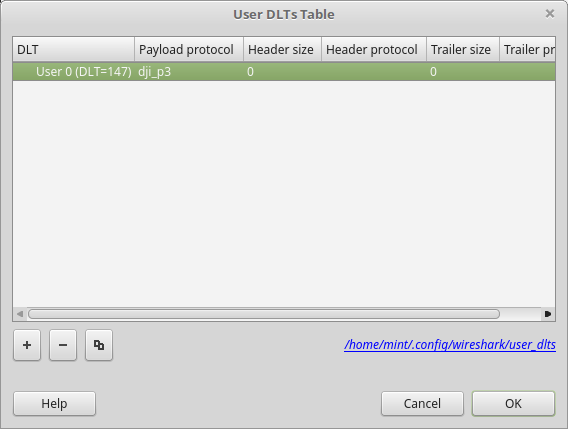
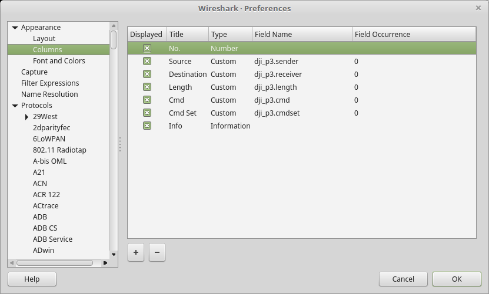
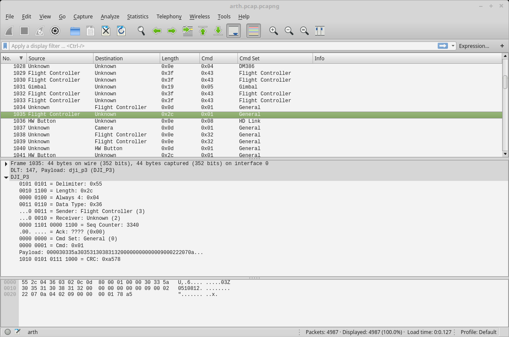

# dji-firmware-tools communication dissector

Utility for analyzing communication in DJI drone interfaces via [Wireshark](https://www.wireshark.org/).

## Rationale

This is a [packet dissector](https://www.wireshark.org/docs/wsdg_html_chunked/ChapterDissection.html) which allows you
to view and analyze communication on interfaces within the DJI drones. The dissectors act as documentation on what is
known about the DJI protocols, in form of simple Lua code.

## Overview

What these dissectors can do:
* Show fields within DUML packets captured from a drone
* Show fields within packets stored in binary Flight Record DAT files
* Export KML file for visualizing the flight

### Mavic 2 Zoom ActiveTrack observation

The DUMLv1 Eye (command set `0x0a`) dissector decodes a 21-byte tracking
selection request (`0x20`), the multi-target list (`0x95`), and the multi-target
state (`0x96`). It also names the observed GO (`0x94`) and stop (`0x97`)
commands. The selection's little-endian session ID is different from the
target index in `0x95`; the latter is used in the GO request.

This layout was checked against a single Mavic 2 Zoom / RC240 native-link
flight on 2026-10-17. After selection, `0x96` changed from 0 to 1 with a
matching person in `0x95`; after GO it changed to 2 for ten seconds; stop
returned the aircraft to GPS flight state. The test established a short
Spotlight session with a nearly stationary person. It did not establish
translation following, the meaning of target-mode values 5 and 3, or support
on other aircraft or firmware versions. A command ACK alone did not prove
target lock in one failed selection attempt. No flight captures or location
telemetry are included here.

Installing the dissectors to Wireshark allows analyzing the protocol commands in:
* PCap files created from pure DUML streams, ie UART communication between chips
* PCap files with dumps of USB/Ethernet communication with embedded DUML payloads, ie. WiFi connection between RC and a drone (for platforms which use that protocol)
* PCap files generated from DAT flight logs

Typically, you will capture the communication using either Wiresharks USB/ETH capture or using `comm_*2pcap.py` scripts. Then open the file in Wireshark.

## Setup

**Note:** Updated for Wireshark 4.4.6

A relatively simple setup is required to use the new dissectors.

### Create a directory outside the Lua folder

If you place all of the Lua files in **or under ** Wireshark's LUA folder, you will likely encounter a series of "Lua: Error during loading" errors when you start Wireshark. To avoid this, create a directory outside Wireshark's plug-in tree. Feel free to create it in your home directory, for example.

(Tech note: If the Lua `dofile` command is only provided a file name (without path), it tries to load the file from the current working directory and that probably won't be where the scripts are located.)

### Copy the script files

Copy **all the Lua files** (`*.lua`) to your new directory (that is outside Wireshark's plug) folder **except** `init.lua`.

Copy `init.lua` to your Wireshark *Personal Lua Plugins* directory. You can locate this directory in the *About Wireshark* dialog under the *Folders* tab. For further information refer to the [directories chapter in official documentation](https://www.wireshark.org/docs/wsug_html_chunked/ChAppFilesConfigurationSection.html).

If Wireshark is running, fully close the application.

Edit `init.lua` to point to the directory into which you copied all of the Lua files. 

In summary, Wireshark will find `init.lua` in your *Personal Lua Plugins* directory, and `init.lua` in turn must contain an absolute path to the rest of the Lua files.

### Start Wireshark

Wireshark will load the new scripts on startup. This will make it recognize the new protocols. In case of issues, refer to [Wireshark documentation on Lua support](https://www.wireshark.org/docs/wsdg_html_chunked/wsluarm.html).

### Associate comm_*2pcap output to new dissector

Now we need setup Wireshark to associate the `*.pcap` files generated by `comm_*2pcap.py` capture script with proper protocol dissector.

First, it would be nice to have a list of existing payload protocol names. Find them by checking `Proto ()` definitions within Lua files. You will find protocols for specific platforms, and more generic ones. There will also be distinction between communication protocols and flight record log protocols. You can list them using:
```
grep -R 'Proto [\(]' ./wireshark/
```
For example, you will get three different protocols for Phantom 3 drones: `dji_p3`, `dji_p3_batt` and `dji_p3_flyrec`; first is for DUML communication, second for battery-to-fc communication, and third for dissecting DAT logs. But you will also get generic DUML protocol dissector, `dji_dumlv1`. Now to associate the protocols with PCap files:

* Choose Edit | Preferences | Protocols

* Scroll down to DLT_USER

* Click Edit, create a new entry (‘+’) and set it up, similar to how it is shown below:

  * Select DLT_USER slot you prefer, 0-15; you will use that slot when creating PCap files

  * Associate the slot with the payload protocol you want, ie. `dji_dumlv1`

  * Repeat until you associate all the needed protocols



If you're using multiple DLT_USER dissectors, remember that you can set `comm_*2pcap.py` parameter to change the user slot while generating PCap file.

### Update columns in list of packets (optional)

You may also want to setup Wireshark’s main display columns:

* Choose Edit | Preferences | Columns

* Setup columns similar to how it is shown below:



Having your own column definitions will greatly increase readability of the packets list,
but you may want to wait until you know which columns you want.

## Usage

After setup is complete, you can load pcap files and get results like this:



You can now analyze DJI communication protocols.
